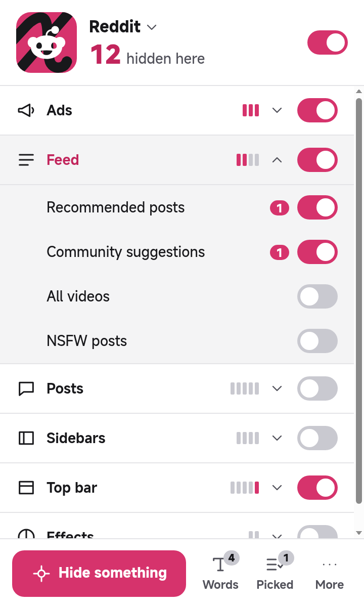
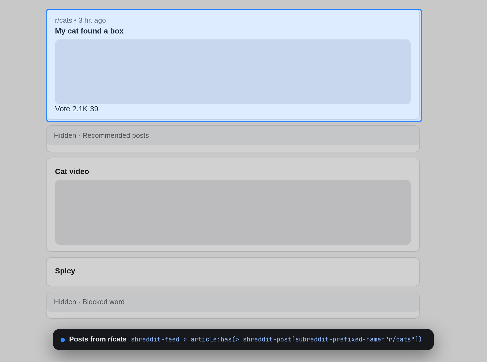
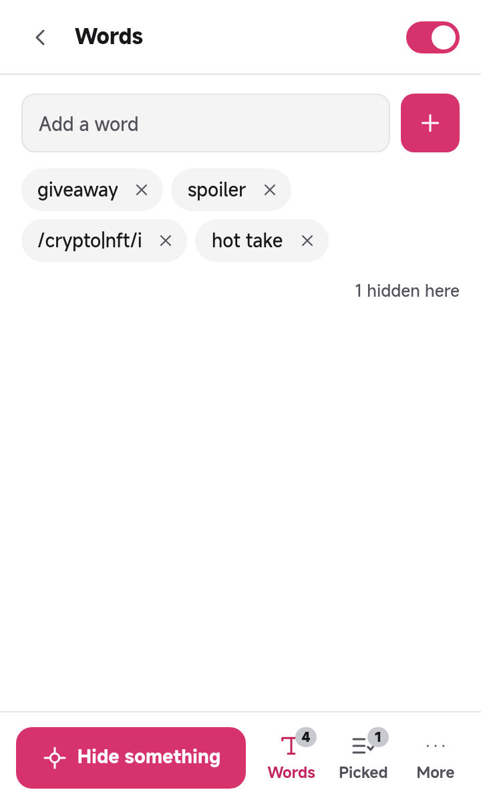
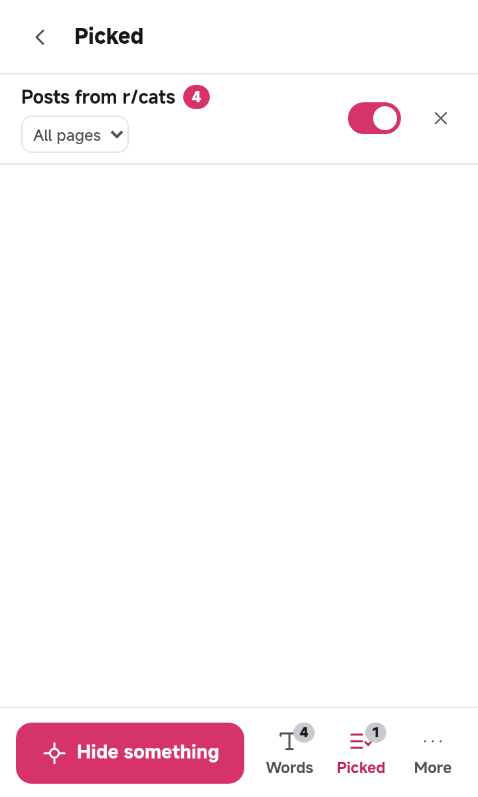
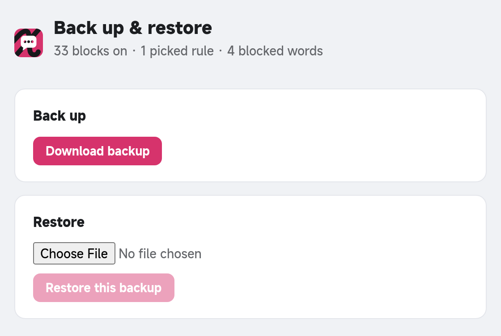

<p align="center">
  
</p>

<h1 align="center">xrnsoc</h1>

A browser extension that hides the distracting parts of social sites: ads,
suggested posts, Reels, sidebars, counts and red badges. Switch off what you
don't want, or click anything else on the page to hide it too.

It works on **Facebook, Reddit, X, LinkedIn, Instagram, Twitch, TikTok, pixiv
and MangaDex**,
in Chrome, Edge, Brave, Firefox and other Chromium or Firefox browsers.

Nothing leaves your browser: no network requests, no analytics, no accounts.

<p align="center">
  
  &nbsp;
  
</p>
<p align="center"><sub>The popup on a Reddit tab, and the picker choosing a community's posts on the test suite's mock page, with two "show" bars left by hidden posts.</sub></p>

## Features

- **Switches for each site.** Ready-made rules grouped by where things are
  (Ads, Feed, Posts, Sidebars, Top bar…). Open a group for its switches, or
  turn the whole group off and on in one go: it remembers what you had on.
  Changes apply at once to every open tab, with no reload. Every site also
  has *Effects*: Black & white, and on the feed sites Blur posts (a post
  sharpens when you hover it); Facebook adds Center feed. Facebook, Reddit,
  X, LinkedIn, Instagram and TikTok have *Stop autoplay*, which pauses a
  video that starts on its own and never one you started.
- **One switch per site.** The switch beside the site's name turns
  xrnsoc off on that site only. The name opens the Sites screen, which
  shows every site and switches the popup to another one.
- **Picker.** Press `Alt+Shift+H` (or **Hide something** in the popup) and
  click anything to hide it. `↑` and `↓` take the part around it or inside
  it, `a` switches between all like it and only this one, `Enter` hides it
  as the click does, and `Esc` cancels. On a phone, tap it, adjust with
  Smaller and Bigger, then tap Hide. Picking a whole post hides posts from
  that author, page or community.
- **Picked rules.** The Picked screen lists what you picked on this site,
  each with a switch, *All pages* or *Only* the page you picked it on, and a
  delete that **Undo** brings back for five seconds.
- **Word blocks.** Hide posts containing a word, or a `/regex/i`. A pattern
  reads the first 1,000 characters of a post, and one that could freeze the
  page (a repeat inside a repeat, such as `(a+)+`) is kept as a plain word.
  Words apply on every site, and have their own on/off switch.
- **"Show" bars.** If you like (More → *Leave a "show" bar*), a hidden post
  leaves a one-line bar that you click to bring the post back. A bar says
  why a post went, but never which blocked word: the site can read it.
- **Pause.** `Alt+Shift+B`, or *Pause all sites* on the Sites screen,
  pauses and resumes every rule. While paused, the toolbar icon says `off`
  and the popup offers **Resume**.
- **Match counts.** The popup shows how many things each switch is hiding
  on the current page, and flags picked rules that match nothing here, are
  for another page, or that the browser can't read any more.
- **A popup that shows what it's doing.** A site xrnsoc is working on
  wears xrnsoc's colours, with the site's symbol in white. Switch the site
  off or pause, and it gets its own logo back.
- **Backup and restore.** All settings go into one file and come back from
  it (More → *Back up or restore*). **Reset** puts every site back to its
  defaults, which also clears your words and picked rules.

<p align="center">
  
  &nbsp;
  
</p>
<p align="center"><sub>Words, shared by every site, and a rule picked on this one.</sub></p>

<p align="center">
  
</p>
<p align="center"><sub>Back up & restore, the extension's options page.</sub></p>

## Supported sites

| Site | Switches | On by default | Status |
| --- | --- | --- | --- |
| Facebook | 34 | 7 | Checked on the live site, October 2026 |
| Reddit | 23 | 6 | Checked on the live site, October 2026 |
| X | 24 | 5 | Checked on the live site, October 2026 |
| LinkedIn | 19 | 3 | Checked on the live site, October 2026 |
| Instagram | 16 | 4 | Checked on the live site, October 2026 |
| Twitch | 14 | 4 | Checked on the live site, October 2026 |
| TikTok | 7 | 1 | Partial: mapped while signed out, no ad switch yet |
| pixiv | 4 | 2 | Checked on the live site while signed out, computer and phone layouts, November 2026 |
| MangaDex | 9 | 2 | Checked on the live site while signed out, November 2026 |

Out of the box, each site hides its ads and its red unread badges where it
has them. On top of that, Facebook hides Reels, suggested posts and "people
you may know" (with Reels on, a reel link lands on the home feed); Reddit
hides recommended posts and community suggestions; X hides promoted trends,
"who to follow" and Premium offers; LinkedIn hides Premium offers;
Instagram hides recommended Reels and suggested accounts; Twitch hides Prime and Bits offers and
recommended channels; pixiv hides Premium offers; and MangaDex hides its
"Advertise" link. TikTok starts with only *Coins and CapCut* on, since it
has no ad switch yet. Every other switch starts off.

## Install

### Chrome, Edge, Brave and other Chromium browsers

1. Get the code: `git clone https://github.com/Xernnn/xrnsoc.git`, or on
   GitHub choose **Code → Download ZIP** and extract it.
2. Open `chrome://extensions` (`edge://extensions` in Edge) and turn on
   **Developer mode**.
3. Click **Load unpacked** and choose the folder that holds `manifest.json`.
4. Reload any tabs of supported sites that were already open.

### Firefox, Zen, LibreWolf and other Firefox browsers (128 or newer)

To keep it installed, in Zen or another build that allows unsigned add-ons
(Developer Edition, Nightly, some forks):

1. In `about:config`, set `xpinstall.signatures.required` to `false`.
2. Build `xrnsoc.zip` as shown under [Build](#build) and rename it to
   `xrnsoc.xpi`.
3. `about:addons` → ⚙ → **Install Add-on From File…** → that file.
4. Reload any tabs of supported sites that were already open. If nothing is
   hidden, open `about:addons` → xrnsoc → **Permissions** and allow it
   on the sites.

An installed `.xpi` doesn't update itself: build and install the next
version the same way. Release Firefox refuses unsigned files; sign the zip
for free with an unlisted upload to addons.mozilla.org instead.

To try it without installing, open `about:debugging` → **This Firefox** →
**Load Temporary Add-on…** and choose `manifest.json`. Firefox removes a
temporary add-on when it closes.

### On a phone

A Chromium browser that takes extensions, such as Quetta on Android, installs
`xrnsoc.zip` from its extensions page. The picker works by touch there
(see Features). There is no self-update: install a newer zip by hand.

### Coming from xrnsocial

Up to 2.0.6 the extension was called xrnsocial. 2.1.0 renamed it xrnsoc
and gave it a new Firefox add-on id, `xrnsoc@xern.dev`, so Firefox and
Zen install it next to the old add-on rather than over it, with nothing
set. To bring your settings across:

1. In xrnsocial: popup → **More** → **Back up or restore** →
   **Download backup**.
2. Install xrnsoc as above.
3. In xrnsoc: popup → **More** → **Back up or restore**, choose that file,
   then **Restore this backup**.
4. Remove xrnsocial (`about:addons` → xrnsocial → ⋯ → **Remove**), so the
   two don't both act on the same pages.

In a Chromium browser, a copy loaded unpacked keeps its settings when you
update its folder in place: the id comes from the folder, and the settings
are stored under the same key as before. A copy loaded from another folder,
or a zip that a phone browser lists as a second extension, starts empty;
the same backup and restore brings the settings across.

## Permissions and privacy

| Permission | What it's for |
| --- | --- |
| `storage` | your switches, words and picked rules, in the browser's local extension storage (not synced through a browser account) |
| `scripting` | putting each picked rule into its page as a stylesheet the site's own scripts can't read |
| `facebook.com`, `messenger.com`, `reddit.com`, `x.com`, `twitter.com`, `linkedin.com`, `instagram.com`, `tiktok.com`, `twitch.tv`, `pixiv.net`, `mangadex.org` | the content script that hides things on those sites; xrnsoc runs nowhere else |

xrnsoc makes no network requests of its own: no analytics, no remote
rules, no account, and the font ships with it. A backup is a file you
download; nothing else leaves the browser. The popup's counts come from the
open tab, by a message inside the browser. The manifest says the same to
Firefox (`data_collection_permissions`: none), which Firefox 140 and newer
show when installing; older versions ignore it.

What a site can still see is under [Known limits](#known-limits): that
something is hidden, but not your words or the accounts you picked.

## Build

There is no compile step: the folder is the extension. Building packs
`manifest.json`, `icons/`, `fonts/` and `src/` into **`xrnsoc.zip`**, the file the
Chrome Web Store and addons.mozilla.org take. It needs
[Node.js](https://nodejs.org) and nothing else: no zip tool, and no
`npm install`.

### Linux

```sh
# Install Node.js from your package manager or nodejs.org, then:
git clone https://github.com/Xernnn/xrnsoc.git
cd xrnsoc
npm run zip
```

### Windows (PowerShell)

```powershell
winget install OpenJS.NodeJS.LTS   # if Node.js isn't installed yet; open a new terminal afterwards
git clone https://github.com/Xernnn/xrnsoc.git   # or Download ZIP and extract it
cd xrnsoc
npm run zip
```

If PowerShell refuses to run `npm` ("running scripts is disabled on this
system"), run `node scripts/zip.js` instead, which does the same thing.

## Tests

The tests need Node.js 22.12 or newer.

```sh
npm install
npm test               # fast checks against mock pages (jsdom)
npm run test:browser   # the extension in a real, headless Chrome for Testing
npm run test:firefox   # the extension in a real Firefox
```

The browser tests need their own browsers, because branded Chrome won't load
an unpacked extension from the command line.

**Linux:** install them where the tests look for them.

```sh
npx @puppeteer/browsers install chrome@stable --path ~/.cache/puppeteer
npx @puppeteer/browsers install firefox@stable --path ~/.cache/bfx-firefox
```

**Windows:** install them, then point the tests at the `.exe` path that each
install command prints.

```powershell
npx @puppeteer/browsers install chrome@stable
npx @puppeteer/browsers install firefox@stable
$env:CHROME_PATH  = "C:\...\chrome.exe"    # the path printed above
$env:FIREFOX_PATH = "C:\...\firefox.exe"
npm run test:browser
npm run test:firefox
```

`test/live/` holds scripts that check the extension against the real,
signed-in sites in a browser you sign in to yourself. Each script's header
comment explains how to run it.

CI (`.github/workflows/ci.yml`) runs all three suites on every push to
`main` and every pull request.

The screenshots in this README come from headless Chromium with the unpacked
extension and made-up settings. The popup is the real one, pointed at a tab
showing `test/fixtures/reddit.html` (the mock page `npm run test:browser`
serves at reddit.com, with plain card styling added so its posts read); the
picker and the "show" bars are on that same page, and nothing reached a real
site.

## How it works

- **One stylesheet**, injected before the page draws, hides everything CSS
  can express. Hidden things never flash into view, and it costs nothing per
  frame.
- **Picked rules stay out of the page.** They say whose posts you hide, and a
  site's scripts can read anything in its page, stylesheets included. So the
  background page injects them with `chrome.scripting`, one stylesheet each:
  the site can't read them, and one broken rule can't break the others.
- **A debounced `MutationObserver`** handles what CSS can't see, such as
  whether a post is an ad or contains a blocked word. Posts are judged again
  whenever their content changes.
- **Hidden elements are marked with an attribute, never a class.** React
  rewrites class names when it re-renders, which used to let hidden ads
  reappear.
- **Rules never use generated class names**, which change with every site
  deploy. They key on roles, labels, test ids and link shapes, measured on
  the live sites.

Each site's rules live in `src/sites/<site>.js`. The engine
(`src/content/engine.js`), the picker, the popup and storage are shared by
all of them.

## Troubleshooting

- **Nothing is hidden on a tab.** Reload it: the content script attaches
  when a page loads, so a tab opened before installing or updating has none.
  The popup's **Hide something** says **Reload tab** in that case. In
  Firefox, also check `about:addons` → xrnsoc → **Permissions**.
- **Everything came back.** Check for a pause (the toolbar icon says `off`,
  and the popup offers **Resume**) and for the site's own switch beside its
  name.
- **One thing came back.** The site changed. Open its group in the popup:
  a switch with no count is matching nothing on this page. Hide it with the
  picker meanwhile.
- **A picked rule says "broken"** (or "none here"). "Broken" means the
  browser no longer reads its selector; "none here" that it matches nothing
  on this page; "other page" that it's set to *Only* another page. Pick the
  thing again and delete the old rule.
- **A picked rule hides too much.** On the Picked screen, set it to *Only*
  the page you picked it on, switch it off, or delete it (Undo brings it
  back for five seconds).
- **"Not saved".** The browser refused to store the change, so nothing was
  changed; try again.

## Known limits

- **Sites change.** When something reappears, hide it again with the picker,
  and the new rule is saved.
- **Video ads inside a stream can't be skipped.** That covers Facebook
  in-stream ads and Twitch ads stitched into the stream; the player still has
  to run them.
- **TikTok has no ad switch yet.** Its ads haven't been measured on a
  signed-in feed. Hide them with the picker for now.
- **Some switches depend on words in the page.** A few Facebook switches
  outside the feed (Marketplace, Notifications, chat) read English labels.
  LinkedIn ads are found by their "Promoted" label, matched in 14 languages.
- **pixiv** was measured signed out, so the home feed you see when signed in
  is unmapped. Ads there use the same frames and should go, but its sections
  have no switches yet.
- **Instagram:** only the home feed is mapped, so ads in Stories, Explore and
  the Reels tab aren't covered.
- **Built against made-up pages, not yet checked on the live sites:**
  Instagram's *Suggested accounts*, *Following feed* and *Explore*. `test/live/check.js` checks it on a
  signed-in browser.
- **Reddit:** the picker can't reach inside Reddit's own components (votes,
  counts, share). Use the switches for those.
- **Facebook Story ads** are untested: the story viewer couldn't be stepped
  through automatically.
- **Sites can tell that something is hidden.** Their scripts can see which
  posts are hidden and by what kind of rule, though not the words you block
  or the accounts you picked. Picked rules arrive a moment after the page's
  own stylesheet, by way of the background page.

## Project layout

```
manifest.json
src/common/      site list and settings storage, shared by every page
src/sites/       one rule pack per site
src/content/     engine, picker, and the bootstrap that runs on each site
src/background/  keyboard shortcuts, the toolbar badge, picked rules' stylesheets
src/popup/       the popup, with each site's icons in src/popup/sites/
src/options/     backup and restore
fonts/           MiSans Latin, the popup's and options page's font, and its licence note
scripts/zip.js   packs the extension (npm run zip)
test/            jsdom, Chrome and Firefox tests, with fixture pages
docs/screenshots the pictures in this README
.github/         CI
```

## History

xrnsoc started as BlockFB, for Facebook only, and was then called
BlockDistractXrn, and xrnsocial until 2.1.0. Backups saved under any of
those names still restore.

## License

[MIT](LICENSE)

Facebook, Messenger, Instagram, Reddit, X, LinkedIn, TikTok, Twitch, pixiv
and MangaDex are trademarks of their owners. Their logos in
`src/popup/sites/` (each site's own logo, and its symbol in white on
xrnsoc's tile) and the popup picture above are here only to name the
sites. xrnsoc has no connection with any of them and isn't endorsed by
them.

The popup and the options page are set in MiSans. MiSans by Xiaomi, used
under the MiSans font licence (free for commercial use when the software
notes that it uses MiSans). The font files are not covered by this
repository's licence. https://hyperos.mi.com/font/en/

The font file, and `fonts/README.md` with the same note, ship with the
extension, so no font is fetched from anywhere.
